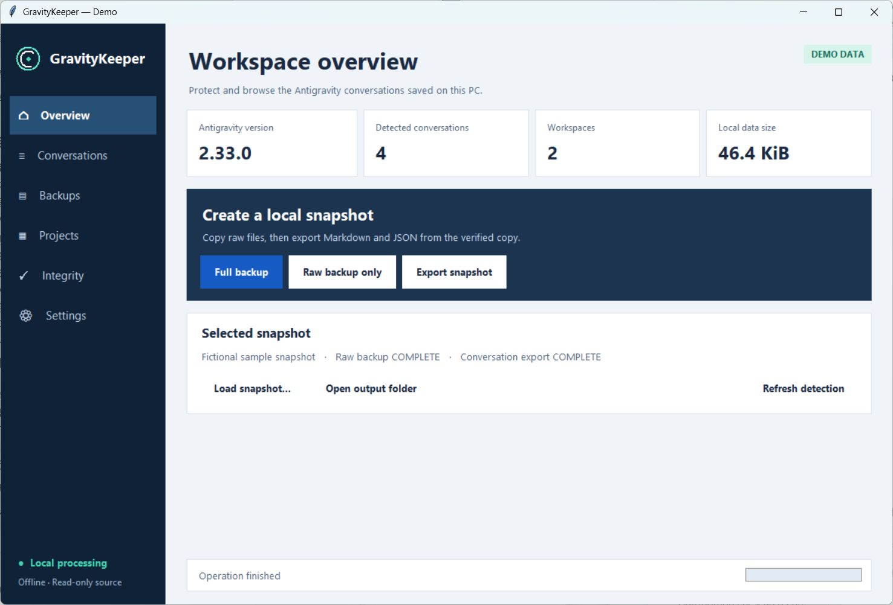

# GravityKeeper

[简体中文](README.zh-CN.md)

**Back up Antigravity conversations while their local files are still available.** If you cannot sign in, are moving to a different PC, or want an offline copy of a project, the conversations already saved on your Windows PC may still be recoverable.

GravityKeeper is a free, unofficial, local-first tool. It is independent of Google and cannot unlock accounts, restore online services, or import conversations into Antigravity. It reads the source data without changing it and works without a Google login or an internet connection.

To preview the desktop with fictional data, run **GravityKeeper.exe --demo** with the portable build, or **python desktop.py --demo** from a source checkout.

[Releases](https://github.com/qweerdad/gravitykeeper/releases)

[Backup management](docs/screenshots/backups.jpg) · [Integrity verification](docs/screenshots/integrity.jpg) · [Chinese conversation browser](docs/screenshots/conversations.jpg)

## Get started

1. Download the Windows x64 portable ZIP and its SHA-256 sidecar from [v0.1.0-rc.1](https://github.com/qweerdad/gravitykeeper/releases/tag/v0.1.0-rc.1). Compare the ZIP hash to the sidecar, then extract the entire ZIP into a folder.
2. Make sure the [Microsoft Visual C++ v14 Redistributable for x64](https://learn.microsoft.com/en-us/cpp/windows/latest-supported-vc-redist) is installed. Double-click **GravityKeeper.exe** and keep the bundled _internal directory next to both executables. The portable build includes Python and uses the Windows UCRT.
3. Review the detected data and backup location in **Settings**. Select **Full backup** to create a timestamped snapshot with raw files, Markdown, JSON, attachments and a workspace index. Select **Raw backup only** if time or disk space is limited.
4. Open **Conversations** to search exported titles, workspaces and message text. Use **Backups** or **Integrity** to create a ZIP, verify an existing snapshot, or open the output folder.

~~~powershell
Get-FileHash -Algorithm SHA256 .\GravityKeeper-0.1.0-rc.1-windows-x64.zip
~~~

## Command line and automation

Open PowerShell in the extracted portable directory. Supply a new destination for each capture. Source checkouts can use **python -m gravitykeeper** instead of **GravityKeeper-CLI.exe**.

~~~powershell
.\GravityKeeper-CLI.exe discover
.\GravityKeeper-CLI.exe run ".\Example snapshot" --progress
.\GravityKeeper-CLI.exe search ".\Example snapshot" "fictional station"
.\GravityKeeper-CLI.exe zip ".\Example snapshot" ".\Example snapshot.zip" --progress
.\GravityKeeper-CLI.exe verify ".\Example snapshot.zip"
~~~

Use **backup** for raw capture and **export** on a sealed snapshot that has not yet been exported. Add **--source** to discover, backup or run to select a known local session data directory. For periodic capture, use Windows Task Scheduler under your own Windows account. Run the CLI with a new timestamped destination each time and review JSON output and process exit codes.

| Exit code | Meaning |
| --- | --- |
| 0 | The command succeeded. For verify, this means the selected hashes match. |
| 2 | Command, input, storage or verification failure |
| 3 | A capture or export returned usable results with incomplete coverage or an export failure |

## What gets recovered

GravityKeeper collects recognized conversation databases, indexes, Brain transcripts and chunks, task records, plans, walkthroughs and recognized attachments. It compares full transcripts and chunks, checks stored SQLite step coverage and preserves source rows and same-session parent links. When possible, it fills gaps from another saved local source. System error decoding requires matching type controls in the same profile. Raw bytes and a materialized SQLite view are retained separately when WAL replay is needed.

| Status | Meaning |
| --- | --- |
| COMPLETE | Available sources supported the reported capture or conversation coverage. |
| PARTIAL | Usable content was saved, with missing, unconfirmed or interrupted evidence recorded. |
| FAILED | The relevant stage yielded no verifiable conversation content or failed to finish. |

Read **JOB_REPORT.json** for separate raw-capture and export statuses. A successfully copied database can be corrupt or unsupported for export. **05_Project_Index/SESSION_VERIFICATION.json** contains per-session reasons and missing SQLite step indices. Files that were never saved locally cannot be recovered.

## Compatibility

| Platform / data format | Candidate status |
| --- | --- |
| Windows 11 x64 | Windows candidate tested locally. See the separate portable and source validation in the acceptance reports. |
| Antigravity 2.33.0 / product 2.33.0.0 | Read-only local detection and SQLite / Brain format validated |
| Windows 10, Windows ARM64, macOS, Linux | Untested for this candidate |
| Other Antigravity versions | Untested. Discovery and byte capture may find compatible files. |
| Opaque legacy .pb without a readable transcript | Byte capture only. No conversation FULL/COMPLETE claim. |
| Source checkout | Python 3.11+ with Tk for the GUI. No third-party runtime packages are required. |

## Troubleshooting

- **Version or workspace count unavailable.** Check the data location in Settings and refresh detection. Version detection reads common Windows installation locations. A locked or unsupported summary database can make the workspace count temporarily unavailable.
- **Locked files.** Open the snapshot report and review failed source entries. Retry into a new, distinct folder when Antigravity has fewer in-flight writes. GravityKeeper can run while Antigravity is open.
- **Insufficient space.** Choose another local drive or save raw files first. Full exports and ZIP creation need additional space. A ZIP must be stored outside the snapshot folder.
- **Missing content.** Preserve the raw snapshot. Compare the per-session anomalies and original logs before relying on a conversation as complete.
- **The portable GUI does not open.** Extract the full ZIP and keep _internal beside the EXEs. If Windows reports a missing VCRUNTIME or MSVCP DLL, install or repair the [official Microsoft x64 redistributable](https://learn.microsoft.com/en-us/cpp/windows/latest-supported-vc-redist). The package is unsigned.

See [privacy](PRIVACY.md), [security reporting](SECURITY.md), [tests](docs/testing.md), [third-party notices](THIRD_PARTY_NOTICES.md), and the [MIT License](LICENSE).
